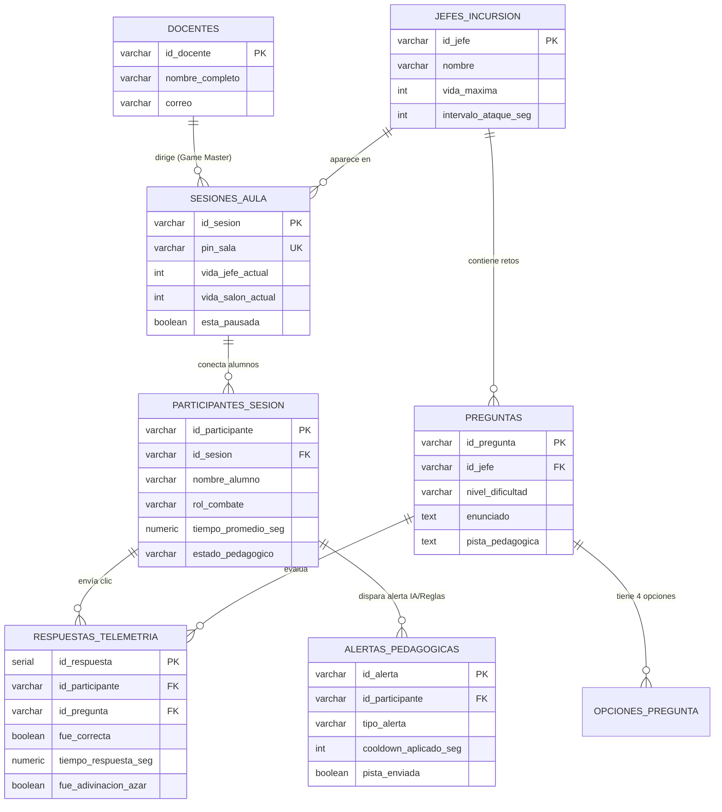

# Capa de Persistencia y Base de Datos (`/Base_Datos`)

Diseño de ingeniería de datos para la plataforma **Jefe de Incursión Educativo (Raid Boss Cooperativo)**.

## 1. Arquitectura de Persistencia en Dos Capas (RAM + Relacional)

Para soportar a **30 alumnos respondiendo de forma concurrente en el mismo segundo** sin generar cuellos de botella por bloqueos de escritura en disco, el sistema implementa un patrón **Write-Behind / Estado en Memoria + Volcado Persistente**:

1. **Capa Caliente en Memoria RAM (Servidor Node.js):** Mantiene el diccionario de estado en vivo de la partida (`bossHp`, `classHp`, `shieldCharges`, rachas y temporizadores) para responder vía WebSockets (`Socket.io`) en `< 20 ms`.
2. **Capa Relacional Persistente (`PostgreSQL` / Almacén Transaccional):** Registra el catálogo de preguntas, las sesiones de aula, la telemetría histórica de cada respuesta y las alertas pedagógicas para el Dashboard del Profesor.

## 2. Diagrama Entidad-Relación (DER)

## 3. Archivos Incluidos

- [`schema.sql`](./schema.sql): Script DDL completo en PostgreSQL con las 8 tablas normalizadas, restricciones `CHECK`, índices de rendimiento y 2 vistas analíticas (`vw_preguntas_mayor_error` y `vw_resumen_telemetria_sesion`).
- [`seed.sql`](./seed.sql): Datos iniciales del **Dragón de las Fracciones**, banco de preguntas con pistas, sesión activa `PIN: 4829` y los 7 perfiles estudiantiles iniciales.
- [`docker-compose.yml`](./docker-compose.yml): Levanta PostgreSQL 16 e inyecta automáticamente `schema.sql` y `seed.sql`.
- [`raid_boss_seed.json`](./raid_boss_seed.json): Base de datos embebida sincronizada automáticamente con el Backend en `/Back` para permitir ejecución inmediata sin requerir Docker instalado durante una demostración rápida.
